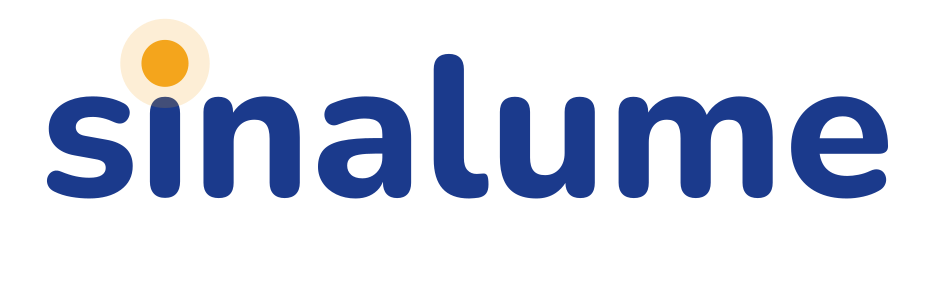

<p align="center"></p>

# Sinalume

**Tradução gratuita entre Libras e português, feita para a comunidade surda.**
Sem fins comerciais, sem anúncios, sem cadastro e com custo zero de operação.

- **Surdo sinaliza → voz:** o ouvinte aponta a câmera; os sinais viram texto na tela e voz.
- **Ouvinte fala → Libras:** a fala vira legenda grande e o avatar do VLibras sinaliza.
- **Modo culto:** legenda enorme e avatar no projetor ou na TV, para pregações e celebrações.
- **Ensinar sinais:** voluntários gravam sinais no próprio app e enviam para a **base da comunidade**.
- **Sinais da comunidade:** depois de uma revisão rápida, cada sinal enviado chega a todos os celulares.

> O Sinalume reconhece um vocabulário limitado e pode errar. Não substitui intérprete de Libras em situações
> importantes, como consultas médicas e assuntos jurídicos.

## Como funciona

```
Câmera ─► MediaPipe (pontos das mãos, no celular) ─► comparação com exemplos (DTW) ─► regras de frase ─► texto + voz
Microfone ─► fala → texto do navegador ─► legenda ─► avatar VLibras ─► sinais
```

| Parte | Tecnologia | Custo |
| --- | --- | --- |
| App | PWA (React + Vite + TypeScript), instalável pelo navegador | R$ 0 |
| Hospedagem | GitHub Pages | R$ 0 |
| Detecção de mãos | MediaPipe Tasks Vision (no aparelho) | R$ 0 |
| Reconhecimento de sinais | DTW + vizinhos mais próximos (no aparelho); rede GRU/ONNX na Fase 1 | R$ 0 |
| Fala → texto e voz | Web Speech API do navegador | R$ 0 |
| Texto → Libras | Avatar VLibras (`vlibras-player-webjs`, LGPL-3.0) | R$ 0 |

**Privacidade:** o vídeo nunca sai do celular. Os sinais gravados ficam só no aparelho até a pessoa exportar.
A fala é transcrita pelo serviço do navegador (Google, no Chrome) e o texto vai ao VLibras para virar Libras.

**Dados móveis:** a primeira abertura baixa ~0,5 MB. O avatar (~14 MB) só é baixado ao abrir uma tela com
avatar, e o detector de mãos (~22 MB) só ao abrir a câmera. Depois tudo fica guardado e o reconhecimento de sinais
funciona sem internet.

## Rodar no computador

Requisitos: Node.js 22+.

```bash
npm install
npm run dev        # abre em http://localhost:5173
npm test           # testes da lógica
npm run build      # gera a versão final em dist/
```

Para testar no celular na mesma rede Wi-Fi, use `npm run dev -- --host` e abra pelo Chrome do Android.
Câmera e microfone exigem HTTPS fora do `localhost` — o GitHub Pages já entrega HTTPS.

## Publicar de graça

1. Crie um repositório **público** no GitHub e envie este código para a branch `main`.
2. Em **Settings › Pages**, escolha **Source: GitHub Actions**.
3. O workflow `.github/workflows/publicar.yml` testa, constrói e publica a cada push.
4. O app fica em `https://<seu-usuario>.github.io/<repositorio>/`. No celular, abra no Chrome e toque em
   **Instalar app** (ou *Adicionar à tela inicial*).

## Base de sinais da comunidade

```
Voluntário grava 5x ─► "Enviar minhas gravações" ─► api/contribuir (Vercel + Vercel Blob, grátis)
   ─► a cada hora, o GitHub Actions busca os envios e abre um Pull Request com a verificação automática
   ─► coordenação clica em Merge ─► GitHub Pages republica public/acervo/
   ─► todos tocam em "Atualizar sinais da comunidade"
```

- Voluntários **não precisam de conta**: basta concordar com o termo (pontos das mãos, sem vídeo, CC BY 4.0).
- A verificação automática avisa quando um sinal parece outro ou quando as repetições estão incoerentes.
- O acervo publicado guarda até 8 exemplos por sinal, alternando pessoas e regiões, separado por categoria.
- Guia de quem aprova: [`docs/APROVAR-CONTRIBUICOES.md`](docs/APROVAR-CONTRIBUICOES.md).

Fontes do acervo:

1. `acervo/base/` — pacotes de bancos públicos. Para o V-LIBRASIL, siga [`training/README.md`](training/README.md)
   e salve o resultado como `acervo/base/pacote-vlibrasil.json`.
2. `acervo/contribuicoes/` — envios aprovados dos voluntários.

Também dá para trocar sinais sem internet: *Exportar sinais* gera um arquivo que outra pessoa importa.

### Configurar a função de envio (uma vez, sem tokens)

1. No [Vercel](https://vercel.com) (plano Hobby, gratuito, uso não comercial), importe o repositório.
2. Em *Storage*, crie um **Blob store** e conecte ao projeto — o Vercel cria `BLOB_READ_WRITE_TOKEN` sozinho.
   Faça um novo deploy.
3. No GitHub, em *Settings › Secrets and variables › Actions › Variables*, crie `API_SINALUME` com o endereço
   do projeto (ex.: `https://sinalume.vercel.app`).
4. Em *Settings › Actions › General*, marque **Read and write permissions** e
   **Allow GitHub Actions to create and approve pull requests**.

Opcional no Vercel: `ORIGENS_PERMITIDAS` (ex.: `https://usuario.github.io`) e `BLOB_ACESSO=public` se o
Blob store for público. Obs.: o GitHub pausa tarefas agendadas após 60 dias sem atividade no repositório.

## Estrutura

```
src/
  lib/maos.ts          detecção de mãos e vetor de características (132 valores por quadro)
  lib/reconhecedor.ts  segmentação de sinais, DTW e classificador
  lib/frase.ts         glosas -> frase em português (regras)
  lib/vocab.ts         vocabulário inicial (cotidiano, saúde, igreja)
  lib/voz.ts           fala -> texto e texto -> voz
  lib/vlibras.ts       avatar VLibras (instância única)
  lib/acervo.ts        exemplos gravados (IndexedDB), exportar/importar
  lib/comunidade.ts    enviar gravações e baixar o acervo da comunidade
  lib/pacote.ts        formato e validação dos pacotes de sinais (app, API e scripts)
  lib/codec.ts         compactação int8 + base64 (~5,6 KB por exemplo)
api/                   funções gratuitas (Vercel): contribuir (recebe) e pendentes (lista para o GitHub)
scripts/               montar acervo público, verificar contribuições, copiar assets
acervo/                base pública + contribuições aprovadas (dados abertos, CC BY 4.0)
  screens/             Início, Ver, Ouvir, Culto, Ensinar, Sobre
training/              extração de pontos, pacote de sinais e treino da rede (Python)
docs/identidade/       logo e ícones
```

## Contribuir

Veja [`CONTRIBUINDO.md`](CONTRIBUINDO.md). Pessoas surdas, intérpretes, igrejas, associações e estudantes são
especialmente bem-vindos — para gravar sinais, testar e revisar o vocabulário.

## Créditos e licenças

- Código do Sinalume: **GPL-3.0-or-later** (veja `LICENSE`).
- Avatar e tradução para Libras: [VLibras](https://vlibras.gov.br) — Governo Federal e UFPB, LGPL-3.0.
- Detecção de mãos: [MediaPipe](https://ai.google.dev/edge/mediapipe) — Google, Apache-2.0.
- Bancos de sinais: [V-LIBRASIL](https://ieee-dataport.org/documents/v-librasil-new-dataset-signs-brazilian-sign-language-libras)
  e [MINDS-Libras](https://zenodo.org/records/2667329), CC BY 4.0 — créditos aos autores. Só os pontos extraídos são
  usados; os vídeos não são redistribuídos.
- Fonte da marca: Nunito (SIL Open Font License).
